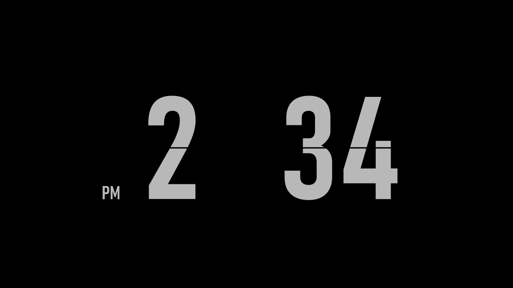

# FlipClock

A lightweight flip clock screensaver for Windows 10 and 11. It is a single 20 KB file and needs nothing installed beyond what Windows already includes.

## Features

- Digits fold over when the time changes
- 12-hour or 24-hour time, with optional seconds
- A clock on every monitor
- Moves slightly each minute to reduce burn-in
- No network access, no telemetry, no admin rights needed

## Build

Run `build.cmd`. It uses the C# compiler that comes with Windows and produces `FlipClock.scr`.

## Install

Right-click `FlipClock.scr` and choose **Install** (on Windows 11 it may be under **Show more options**). Windows opens Screen Saver Settings with FlipClock selected. Keep the file where it is, because Windows runs it from that location.

To change the time format or show seconds, click **Settings** in that window. Settings are saved in `%LOCALAPPDATA%\FlipClock\settings.ini`.

To uninstall, choose a different screensaver, then delete `FlipClock.scr` and the `%LOCALAPPDATA%\FlipClock` folder.

## Known limitations

- Tested on one Windows 11 PC with a single monitor. Multiple monitors are supported in the code but have not been tested.
- The file is not code-signed, so Windows SmartScreen or antivirus tools may warn about it.
- It draws without the graphics card to keep memory use low, so flips may look less smooth on very large screens.

## License

[MIT](LICENSE)
